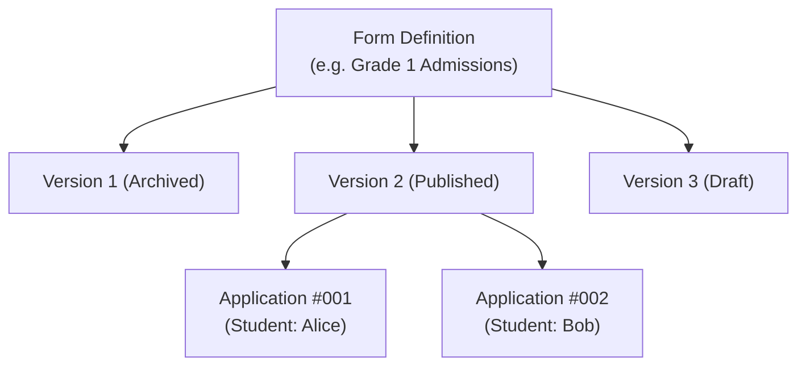

# 🎓 Academic Structure & Dynamic Admissions

## 1. Academic Hierarchy

The academic module organizes school operations into a clear hierarchy:

```text
School (e.g. Oakridge International Academy)
 ├── Campuses (Main Campus, North Campus)
 └── Academic Years (e.g. 2026-2027)
      ├── Academic Terms (Fall 2026, Spring 2027)
      └── Classes (Grade 1, Grade 2, Grade 3)
           └── Sections (Section A, Section B)
```

### 1.1 Academic Lifecycle Rules
- **Non-Overlapping Terms:** Terms within the same academic year must have contiguous, non-overlapping date intervals.
- **Section Capacity Enforcements:** Sections enforce a maximum student enrollment limit (`MaxCapacity`) to prevent classroom overcrowding.

---

## 2. Students & Guardian Management

### 2.1 Student Entity Lifecycle
Students progress through a formal state machine:
- `Applied`: Application submitted and approved, awaiting enrollment.
- `Enrolled`: Actively attending classes.
- `Promoted`: Completed an academic year and advanced to the next grade.
- `Suspended`: Temporarily restricted from classes and activities.
- `Withdrawn`: Formally unenrolled by guardian request.
- `Graduated`: Completed the school's highest academic grade.

### 2.2 Multi-Guardian Relationships
Real-world families often involve multiple guardians (e.g., biological parents, step-parents, grandparents, legal guardians).
- Every student can be linked to multiple guardians via the `student_guardians` association.
- **Role Flags:**
  - `IsPrimary`: Identifies the main point of contact.
  - `ReceivesBilling`: Designates who receives invoices, payment reminders, and fee receipts.
  - `CanPickup`: Security flag checked by front-desk staff before releasing students.
  - `Priority`: Integer priority order used when dispatching emergency calls.

---

## 3. Dynamic Admission Form Engine

Schools require customized admission forms that vary across grades, educational boards, and geographic jurisdictions. Rather than hardcoding static form fields, SMS includes a **Dynamic Admission Form Engine**.

### 3.1 Form Architecture


### 3.2 Schema Structure (`admission_form_versions`)
A form version's JSON schema defines structured sections and typed fields:
```json
{
  "sections": [
    {
      "id": "personal_info",
      "title": "Personal Information",
      "fields": [
        {
          "id": "first_name",
          "label": "First Name",
          "type": "text",
          "required": true
        },
        {
          "id": "blood_group",
          "label": "Blood Group",
          "type": "dropdown",
          "options": ["A+", "A-", "B+", "B-", "O+", "O-", "AB+", "AB-"],
          "required": false
        }
      ]
    }
  ]
}
```

### 3.3 Supported Field Types
- `text`: Single-line text input.
- `number`: Numeric value with min/max constraints.
- `date`: Civil date selector (`YYYY-MM-DD`).
- `dropdown`: Select list from predefined options.
- `radio`: Single choice among mutually exclusive options.
- `checkbox`: Boolean toggle or multi-select.
- `textarea`: Multi-line text for background or medical notes.
- `file`: Required document upload.

### 3.4 Versioning & Immutability Rules
- **Drafts:** Administrators can modify, reorder, and remove fields freely in `draft` mode.
- **Published:** Once a version is marked `published`, it becomes **immutable**. Any submitted applicant responses are tied permanently to that exact schema version.
- **Evolutions:** Modifying a published form creates a new incremental version (e.g., v2 $\rightarrow$ v3).

---

## 4. Content-Addressed Document Storage

Student attachments (birth certificates, immunization cards, transcripts, photos) are managed through a **Content-Addressed Blob Store**:

1. **Storage Path:** Files are hashed using **`SHA-256`** and stored on disk under:
   ```text
   %LOCALAPPDATA%\SchoolManagement\documents\ab\cd\<sha256-hash>
   ```
2. **Automatic Deduplication:** If two applicants submit identical health record templates, only one file is saved on disk; multiple database records point to the same content hash.
3. **Tamper Detection:** When serving documents, the system recomputes the SHA-256 digest to detect unauthorized manual modifications or disk corruption.

