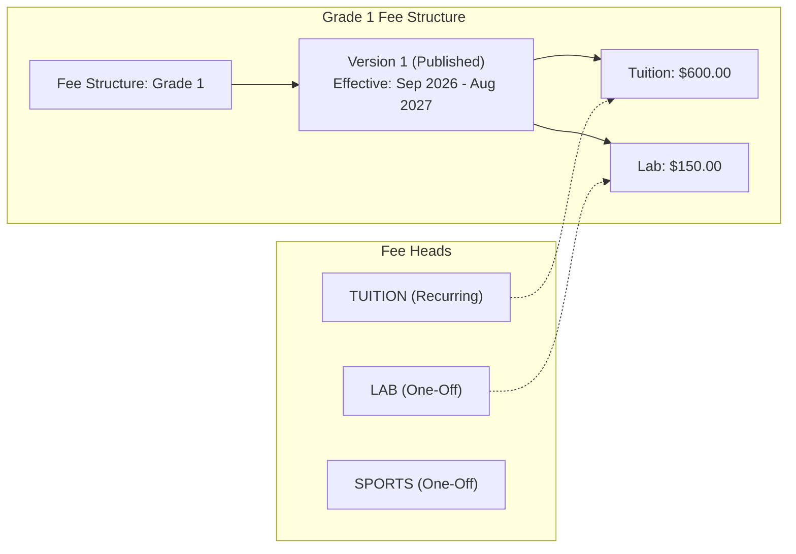
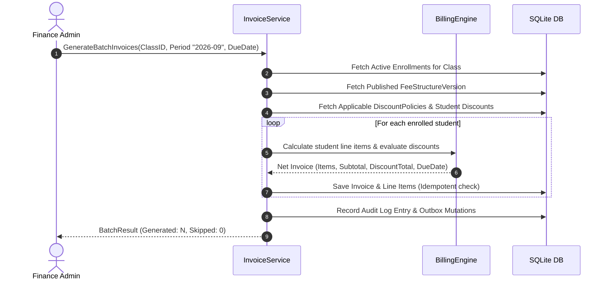

# Fees Engine & Batch Invoicing

## 1. Domain Foundations: Exact Financial Precision

School billing requires strict financial auditability. To prevent penny rounding anomalies and currency drift:

- **Minor Currency Units:** Every price, balance, and transaction is represented as an integer `int64` (e.g., $150.00 is stored and calculated as `15000`).
- **Basis Points (bps):** Discount rates and percentage modifiers are stored as integer basis points (1% = `100 bps`, 25% = `2500 bps`).
- **Deterministic Rounding:** Multiplication of basis points against minor amounts uses integer division with half-up rounding:
  $$\text{DiscountMinor} = \left\lfloor \frac{\text{AmountMinor} \times \text{BasisPoints} + 5000}{10000} \right\rfloor$$

---

## 2. Fee Structures & Immutability

### 2.1 Immutability of Financial Schedules
Once a fee structure version is published, it is **locked permanently**.
- If school fees increase mid-year, administrators create **Version 2**.
- Historical invoices remain locked to Version 1, preventing audit discrepancy disputes.

---

## 3. Automated Discount Policy Engine

Discounts are evaluated automatically during batch invoicing.

### 3.1 Supported Policy Types
1. **Sibling Concessions (`sibling`):**
   - Counts active enrolled students sharing the same primary guardian.
   - Example: 1st child pays 100%, 2nd child receives 20% discount (`2000 bps`), 3rd child receives 30% discount (`3000 bps`).
2. **Merit Scholarships (`merit`):**
   - Awarded based on academic grading or test scores.
3. **Staff Child Concessions (`staff`):**
   - Fixed percentage or minor unit waiver for children of faculty members.
4. **Custom Concessions (`custom`):**
   - Discretionary principal waivers with mandatory justification notes.

---

## 4. Batch Invoicing Pipeline

Batch invoicing converts published fee structures and student enrollments into issued invoices across an entire class or grade.

### 4.1 Idempotency & Duplicate Prevention
Batch invoicing operations are completely idempotent. Running invoice generation twice for the same billing period (`2026-09`) will detect existing invoices for each student and safely skip them without creating duplicate charges.

### 4.2 Calculated Overdue Tracking
In traditional systems, a scheduled cron job runs nightly to change status from `issued` $\rightarrow$ `overdue`. This approach is fragile in offline desktop software that may be turned off over weekends.

Instead, **overdue status is calculated dynamically** when querying invoices:
$$\text{IsOverdue} = (\text{Status} \in \{\text{issued}, \text{partially\_paid}\}) \land (\text{DueDate} < \text{Today}_{\text{SchoolTZ}}) \land (\text{BalanceMinor} > 0)$$
This guarantees that overdue penalties and flags display accurately the instant the app is opened, regardless of how long the computer was powered off.

