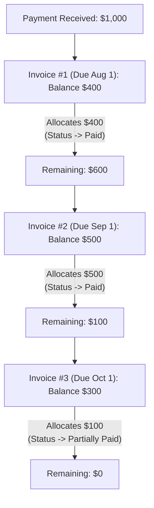

# Payments, Sequential Receipts & Advance Credit

## 1. Sequential Receipt Generation

Tax authorities and educational accreditation boards require unbroken, sequential receipt numbers without gaps.

### 1.1 Receipt Numbering Pattern
```text
RCP-[YEAR]-[6-DIGIT SEQUENCE]
Examples: RCP-2026-000001, RCP-2026-000002, RCP-2026-000003
```

### 1.2 Atomic Sequence Allocation
To guarantee no two cashiers receive the same receipt number during rapid counter transactions, sequence allocation is handled directly in SQL inside an atomic transaction:

```sql
INSERT INTO receipt_sequences (school_id, calendar_year, last_sequence)
VALUES (?, ?, 1)
ON CONFLICT(school_id, calendar_year)
DO UPDATE SET last_sequence = receipt_sequences.last_sequence + 1
RETURNING last_sequence;
```

---

## 2. Automated FIFO Allocations

When a parent makes a payment (e.g., $1,000) against an account with multiple unpaid charges, the system uses **First-In, First-Out (FIFO)** allocation:



### Allocation Rules:
1. Outstanding invoices with status `issued` or `partially_paid` are sorted by `due_date ASC`, then `created_at ASC`.
2. For each invoice:
   - $\text{AmountToAllocate} = \min(\text{RemainingPayment}, \text{InvoiceBalance})$.
   - An immutable record is created in `payment_allocations`.
   - The invoice's `paid_amount_minor` increases and `balance_minor` decreases.
   - If `balance_minor == 0`, status becomes `paid`. If `balance_minor > 0`, status becomes `partially_paid`.
3. If all invoices are fully paid and a surplus remains, the remaining amount is deposited into the student's **Advance Credit Ledger**.

---

## 3. Student Advance Credit Ledger

Overpayments (e.g., a parent paying $1,000 when only $800 is owed) do not cause errors or negative balances on individual invoices.

- The surplus ($200) is saved into the student's `credit_balances` aggregate.
- **Credit Drawdown:** When subsequent invoices are generated, available credit can be automatically allocated against new invoices, issuing an internal payment without requiring cash exchange.
- **Full History:** Every deposit and drawdown in the credit balance is tracked with timestamps, references, and audit logs.

---

## 4. Payment Reversals & Bounced Cheques

If a payment was recorded in error or a cheque bounces:
1. An accountant initiates a **Payment Reversal** providing a mandatory reason code.
2. The reversal operation executes within an atomic transaction:
   - Sets the payment status to `reversed`.
   - Reverts each `payment_allocation` linked to that payment.
   - Restores the corresponding invoice balances and updates their statuses from `paid` back to `issued` or `partially_paid`.
   - Deducts any surplus that had previously been credited to the student's credit ledger.
   - Appends an entry to the `payment_reversals` ledger and records an audit event.

---

## 5. Financial Adjustments (Waivers & Write-offs)

Adjustments represent non-cash corrections to an invoice's outstanding balance:

| Adjustment Type | Description | Effect |
|---|---|---|
| **Waiver** | Administrative discount approved post-issuance (e.g., hardship concession). | Decreases invoice balance, increases `adjusted_amount_minor`. |
| **Write-off** | Uncollectible bad debt for withdrawn or departed students. | Closes invoice balance to zero, marking it as written off for accounting. |
| **Correction** | Correction of an administrative billing mistake. | Adjusts invoice balance up or down with mandatory supervisor note. |

